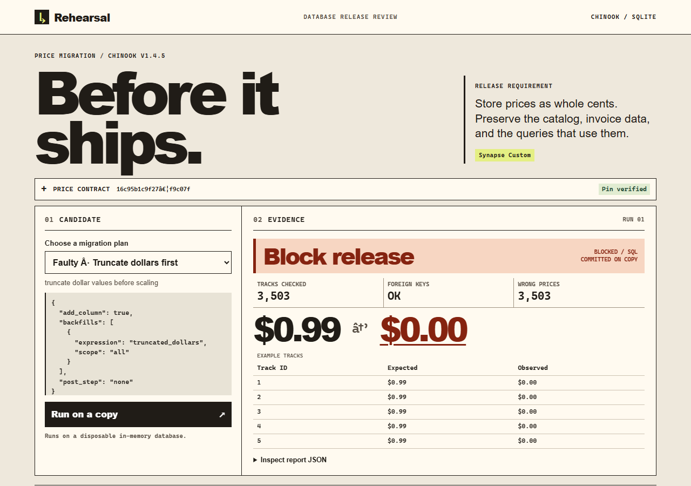

# Migration Rehearsal

**SQLite committed the migration. All 3,503 converted prices were wrong.**

Migration Rehearsal runs a candidate on a disposable copy of the Chinook database, then checks the result against a pinned contract. In the demo, track 1 goes from **$0.99 to $0.00** while the foreign key check still passes. One Synapse Custom MCP call catches the error and returns the affected count and example rows.

Built for **Vibe-a-thon Track 2** · Python · SQLite · Synapse Custom

[Watch the captioned demo](migration-rehearsal-demo.mp4?raw=1) · [Try it locally](#try-it-locally) · [Read the live results](#live-agent-comparison)

[](migration-rehearsal-demo.mp4?raw=1)

## Try it locally

With Git and Python 3.12 or later, clone the repo and start the workbench. This path uses the Python standard library and the bundled fixture. It needs no API key, account, or package install.

```sh
git clone https://github.com/hehehehehee-dev/migration-rehearsal.git
cd migration-rehearsal
python workbench.py
```

Open [localhost:8765](http://127.0.0.1:8765) and follow these four cases:

1. **Truncate dollars first.** Select **Run on a copy**. SQL commits, the foreign keys pass, and the contract blocks 3,503 incorrect prices.
2. **Round after scaling.** Change the candidate and rerun. All 3,503 prices pass the same contract.
3. **No backfill scope.** Review the clarification result. The tool needs to know which tracks to backfill.
4. **Convert currency.** Review the unsupported result. Both scope cases stop before SQL runs.

To run the same workbench through the generated **Synapse Custom MCP server**, stop the first server and run:

```sh
python -m pip install -r requirements.txt
python workbench.py --server rehearse_database_migration_server.py
```

## What Synapse composes

The [generated server](rehearse_database_migration_server.py) exposes one tool, `rehearse_database_migration`. It calls six existing Python functions in order:

```text
Validate → Snapshot → Capture baseline → Execute → Verify → Report
```

The operator approves the exact candidate. The engine checks the [contract pin](fixtures/contract.json) before SQL runs and before issuing the verdict. It makes the copy from the hash-checked Chinook fixture, runs a bounded set of operations, and checks protected records, indexes, foreign keys, application queries, and every converted price. The report includes the candidate and contract identities, execution status, the verdict, and examples where a check fails.

| Outcome | Meaning |
| --- | --- |
| **Passed** | The result satisfies the pinned checks on this copy. |
| **Blocked** | A check failed or the candidate could not run as submitted. |
| **Unclear** | The tool could not establish a result, for example because the scope is missing, a run timed out, or the contract changed. |
| **Unsupported** | The operation or scope falls outside the USD-to-integer-cents workflow. |

The approved fixture is read from disk and checked before use. Every mutation happens in memory. The tool accepts named operations and scopes, and the workbench binds to loopback.

## Results you can reproduce

Both MCP surfaces matched **26/26 labeled cases**, including **14/14 holdouts**, with zero misses. Both replays left the fixture byte for byte identical. A match requires the expected verdict, exact reason codes, and the verified contract digest. The two scope cases also require that SQL never ran.

- [Labeled plans and expected results](fixtures/cases.jsonl)
- [Synapse MCP benchmark](mcp-benchmark-results.json) and [separate-tool benchmark](small-benchmark-results.json)
- [Faulty candidate report](demo-blocked.json) and [corrected candidate report](demo-passed.json)

```sh
python -m unittest -v
python demo.py benchmark --confirm
python mcp_replay.py --server rehearse_database_migration_server.py --confirm
```

The first two checks use the local engine. The third uses MCP and needs the dependencies installed above. The benchmark flag authorizes only the bundled test suite.

## Live agent comparison

The same local **Qwen2.5-Coder-1.5B** model received the same approved candidates and instructions. One setup exposes the composed Synapse tool. The other exposes the same six Python phases as separate MCP tools. The agent sees the next-phase hint from each tool response while all six baseline tools remain available.

| Candidate | Synapse Custom | Six separate tools | Trace |
| --- | --- | --- | --- |
| Truncate dollars first | Blocked · 1 call | Blocked · 7 calls | [JSON](integration-results.json) |
| Round after scaling | Passed · 1 call | Passed · 7 calls | [JSON](integration-corrected-results.json) |
| Missing backfill scope | Unclear · 1 call | Incomplete · 10 calls | [JSON](integration-unclear-results.json) |
| Currency conversion | Unsupported · 1 call | Unsupported · 7 calls | [JSON](integration-unsupported-results.json) |

The separate-tool agent hit its call limit on the missing-scope case after repeatedly asking for a report before verification. The traces show every rejected call. The scripted replay demonstrates that the separate tools produce the correct result when called in order.

The evidence covers four live candidates, one local model, and one migration family on a single public database. The workbench is a local review tool. Its confirmation assumes a trusted local operator.

<details>
<summary>Regenerate the Synapse server, rerun the live agent, or record the demo</summary>

### Regenerate the MCP server

Use Node.js 20+ and a running OpenAI-compatible endpoint:

```powershell
npm install --prefix .tooling @2ndbrainlabs-ai/synapse-cli@0.1.9
.\build_synapse.ps1 -Endpoint http://127.0.0.1:11455/v1 -Model your-model
```

[Synapse Custom mode](https://github.com/2ndbrainlabs-ai/synapse-cli-ts#build-modes-auto-and-custom) emits the server in `.tooling/codegen`. Review the generated file before copying it to the project root. The checked-in file fixes a stray module-name line and a generated Python type annotation. Its six-phase body comes from Synapse. The [generation log](synapse-build.log) documents the build.

### Repeat the live comparison

Use a compatible local inference endpoint or start the bundled adapter with your Qwen GGUF:

```sh
npm install --prefix .tooling node-llama-cpp@3.16.2
node local_model.mjs path/to/model.gguf
```

In another terminal, run:

```sh
python mcp_replay.py --server rehearse_database_migration_server.py --confirm --base-url http://127.0.0.1:11455/v1 --model qwen2.5-coder-1.5b --agent-case whole_dollars --integration-output my-live-trace.json
```

The other live case IDs are `round_cents`, `missing_backfill_scope`, and `currency_conversion`. The trace retains the full tool response. The model receives a condensed copy for its final summary.

### Capture the workbench and render the MP4

On Windows with Edge and the Python dependencies installed:

```sh
npm install --prefix .tooling playwright-core
node verify_workbench.mjs rehearse_database_migration_server.py
python make_video.py
```

</details>

## Credits

The [Chinook SQLite v1.4.5 fixture](https://github.com/lerocha/chinook-database/releases/tag/v1.4.5) is bundled under its [upstream license](fixtures/CHINOOK-LICENSE.md). [Dấu](https://github.com/roberthuynh/dau-tones) inspired the demo-first presentation and keyless quick start. [ORCA](https://github.com/IssueLab-Limited/ORCA-hackathon-2026) informed how the benchmark and its limits are presented. [W3C guidance](https://www.w3.org/WAI/WCAG22/Understanding/use-of-color.html) and the [GOV.UK status tag pattern](https://design-system.service.gov.uk/components/tag/) informed the workbench's outcome labels.
