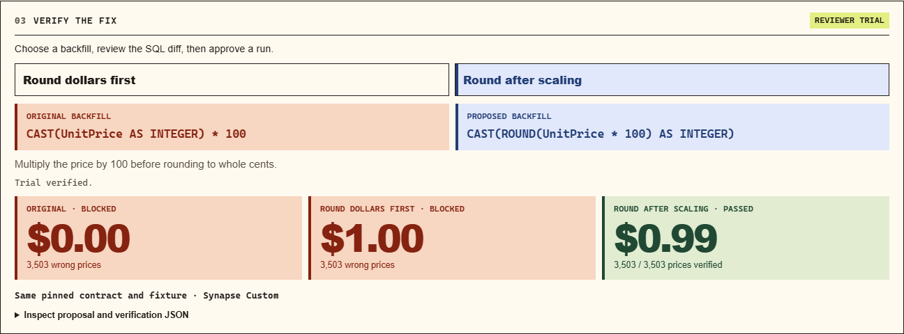
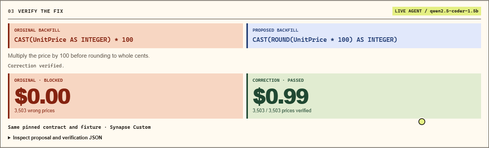

# Migration Rehearsal

**SQLite committed the migration. All 3,503 converted prices were wrong.**

Migration Rehearsal runs a candidate on a disposable copy of the Chinook database, then checks the result against a pinned contract. In the demo, track 1 goes from **$0.99 to $0.00** while the foreign key check still passes. One Synapse Custom MCP call catches the error and returns the affected count and example rows.

Built for **Vibe-a-thon Track 2** · Python · SQLite · Synapse Custom

[Watch the captioned submission demo (2:53)](https://raw.githubusercontent.com/hehehehehee-dev/migration-rehearsal/main/migration-rehearsal-demo.mp4?v=submission-253-reviewer) · [Try two backfills](#try-two-backfills-yourself) · [Try it locally](#try-it-locally) · [Read the live results](#live-agent-comparison) · [Connect an agent](#connect-another-mcp-client)

[](https://raw.githubusercontent.com/hehehehehee-dev/migration-rehearsal/main/migration-rehearsal-demo.mp4?v=submission-253-reviewer)

## Try it locally

With Git and Python 3.12 or later, clone the repo and start the workbench. This path uses the Python standard library and the bundled fixture. It needs no API key, account, or package install.

```sh
git clone https://github.com/hehehehehee-dev/migration-rehearsal.git
cd migration-rehearsal
python workbench.py
```

Open [localhost:8765](http://127.0.0.1:8765). Start with [the two-backfill trial](#try-two-backfills-yourself) or explore these cases:

1. **Truncate dollars first.** Select **Run on a copy**. SQL commits, the foreign keys pass, and the contract blocks 3,503 incorrect prices.
2. **Round after scaling.** Change the candidate and rerun. All 3,503 prices pass the same contract.
3. **No backfill scope.** Review the clarification result. The tool needs to know which tracks to backfill.
4. **Convert currency.** Review the unsupported result. Both scope cases stop before SQL runs.

To run the same workbench through the generated **Synapse Custom MCP server**, stop the first server and run:

```sh
python -m pip install -r requirements.txt
python workbench.py --server rehearse_database_migration_server.py
```

## Try two backfills yourself

1. Run **Truncate dollars first**, then select **Try two backfills**.
2. Select **Round dollars first**, review the SQL diff, and select **Approve trial on a copy**. The track reads **$1.00** and the report blocks all **3,503** wrong prices.
3. Select **Round after scaling**, review the new diff, and approve this trial. The workbench keeps both results in view. The second trial reads **$0.99** and verifies **3,503/3,503** prices under the same pinned contract and fixture.

The reviewer chooses these two backfills. Every verdict comes from a new run on a disposable copy.

## Watch the agent repair a failed plan

Run **Truncate dollars first**, then select **Review recorded agent fix**. Review the one-expression diff and select **Run corrected plan on a copy**. The workbench shows the same track at **$0.00 before** and **$0.99 after**, with **3,503/3,503 prices verified** under the same pinned contract and fixture.



The keyless quick start uses a [recorded Qwen proposal](repair-proposal.json) tied to the original plan and contract. Both rehearsals run on your machine. To generate a fresh proposal with a running local model, pass `--model-url http://127.0.0.1:11455/v1 --model qwen2.5-coder-1.5b` when starting the MCP workbench. Select **Ask agent for a fix** to try it.

For an isolated price conversion failure, the model selects one permitted expression. The workbench shows the SQL diff and waits for approval of the exact draft. Synapse verifies it with one call to the same composed tool.

## What Synapse composes

The [generated server](rehearse_database_migration_server.py) exposes one tool, `rehearse_database_migration`. It calls six existing Python functions in order:

```text
Validate → Snapshot → Capture baseline → Execute → Verify → Report
```

The tool advertises a [typed plan object](mcp_plan.py) through MCP `tools/list`. The host approves the digest of the canonical plan. The engine checks the [contract pin](fixtures/contract.json) before SQL runs and before issuing the verdict. It makes the copy from the hash-checked Chinook fixture, runs a bounded set of operations, and checks protected records, indexes, foreign keys, application queries, and every converted price. The report includes the candidate and contract identities, execution status, the verdict, and examples where a check fails.

| Outcome | Meaning |
| --- | --- |
| **Passed** | The result satisfies the pinned checks on this copy. |
| **Blocked** | A check failed or the candidate could not run as submitted. |
| **Unclear** | The tool could not establish a result, for example because the scope is missing, a run timed out, or the contract changed. |
| **Unsupported** | The operation or scope falls outside the USD-to-integer-cents workflow. |

The approved fixture is read from disk and checked before use. Every mutation happens in memory. The tool accepts named operations and scopes, and the workbench binds to loopback.

## Results you can reproduce

Both MCP surfaces matched **26/26 labeled cases**, including **14/14 holdouts**, with zero misses. Both replays left the fixture byte for byte identical. A match requires the expected verdict, exact reason codes, and the verified contract digest. The two scope cases also require that SQL never ran.

- [Labeled plans and expected results](fixtures/cases.jsonl)
- [Synapse MCP benchmark](mcp-benchmark-results.json) and [separate-tool benchmark](small-benchmark-results.json)
- [Faulty candidate report](demo-blocked.json) and [corrected candidate report](demo-passed.json)

```sh
python -m unittest -v
python demo.py benchmark --confirm
python mcp_replay.py --server rehearse_database_migration_server.py --confirm
```

The first two checks use the local engine. The third uses MCP and needs the dependencies installed above. The benchmark flag authorizes only the bundled test suite.

## Live agent comparison

The same local **Qwen2.5-Coder-1.5B** model received the same approved candidates and instructions. One setup exposes the composed Synapse tool. The other exposes the same six Python phases as separate MCP tools. The agent sees the next-phase hint from each tool response while all six baseline tools remain available.

The model selects which tool to call. The runner and workbench display the verdict and evidence from the final tool report. For example, the faulty plan shows **Blocked. Price cents mismatch (3,503).** The JSON trace retains the exact issue codes. A run without a final tool report appears as **Incomplete**.

| Candidate | Synapse Custom | Six separate tools | Trace |
| --- | --- | --- | --- |
| Truncate dollars first | Blocked · 1 call | Blocked · 7 calls | [JSON](integration-results.json) |
| Round after scaling | Passed · 1 call | Passed · 7 calls | [JSON](integration-corrected-results.json) |
| Missing backfill scope | Unclear · 1 call | Unclear · 7 calls | [JSON](integration-unclear-results.json) |
| Currency conversion | Unsupported · 1 call | Unsupported · 7 calls | [JSON](integration-unsupported-results.json) |

Both live setups reached the expected verdict on all four candidates. The separate-tool agent requested the report before verification once per case, then recovered. The scripted replay completes the same workflow in six calls when the tools run in order.

The evidence covers four live candidates, one local model, and one migration family on a single public database. The workbench is a local review tool. Its confirmation assumes a trusted local operator.

## Connect another MCP client

Install the Python dependencies above. In a client that supports MCP over stdio, set the command to that Python executable and pass the absolute path to the generated server. This example grants approval for the bundled faulty plan.

```json
{
  "mcpServers": {
    "migration-rehearsal": {
      "command": "python",
      "args": ["/absolute/path/to/migration-rehearsal/rehearse_database_migration_server.py"],
      "env": {
        "REHEARSAL_APPROVED_PLANS": "a28e5cf4e18a763adc1f27625e559b8c9cf5661b3ea1b29f81a3fbd835b3854f"
      }
    }
  }
}
```

Ask the agent to call `rehearse_database_migration` with this `plan` object. The server canonicalizes the object for approval, so whitespace and object key order can vary. Changing a value or reordering the backfills requires a new approval.

```json
{
  "plan": {
    "add_column": true,
    "backfills": [{"expression": "truncated_dollars", "scope": "all"}],
    "post_step": "none"
  }
}
```

Expect `blocked`, `sqlite_committed_on_copy`, and `price_cents_mismatch.count` of `3503`. To approve another plan, save the inner object in `plan.json`, compute its digest from the repo directory, then set `REHEARSAL_APPROVED_PLANS` in your MCP host to the result and restart the server.

```sh
python -c "import json; from rehearsal import canonical, fingerprint; print(fingerprint(canonical(json.load(open('plan.json', encoding='utf-8')))))"
```

The benchmark runner supplies approval for all bundled cases when the operator passes `--confirm`.

<details>
<summary>Rerun the live agent or rebuild the server and demo</summary>

### Regenerate the MCP server

Use Node.js 20+ and a running OpenAI-compatible endpoint:

```powershell
npm install --prefix .tooling @2ndbrainlabs-ai/synapse-cli@0.1.9
.\build_synapse.ps1 -Endpoint http://127.0.0.1:11455/v1 -Model your-model
```

[Synapse Custom mode](https://github.com/2ndbrainlabs-ai/synapse-cli-ts#build-modes-auto-and-custom) emits the six-phase composition in `.tooling/codegen`. Compare that output with the checked-in server. The checked-in MCP boundary imports `MigrationPlan`, accepts `plan: MigrationPlan`, and passes `plan.canonical_json()` to the first phase. Preserve those lines when bringing in an updated composition. The [generation log](synapse-build.log) documents the build.

### Repeat the live comparison

Use a compatible local inference endpoint or start the bundled adapter with your Qwen GGUF:

```sh
npm install --prefix .tooling node-llama-cpp@3.16.2
node local_model.mjs path/to/model.gguf
```

In another terminal, run:

```sh
python mcp_replay.py --server rehearse_database_migration_server.py --confirm --base-url http://127.0.0.1:11455/v1 --model qwen2.5-coder-1.5b --agent-case whole_dollars --integration-output my-live-trace.json
```

The other live case IDs are `round_cents`, `missing_backfill_scope`, and `currency_conversion`. The trace retains the structured MCP arguments and full tool response alongside the report-based summary.

### Capture the workbench and render a local replay

This recipe renders the short local replay. The extended submission cut uses separate narration and is linked above.

On Windows with Edge and the Python dependencies installed:

```sh
npm install --prefix .tooling playwright-core
node verify_workbench.mjs rehearse_database_migration_server.py
python make_video.py
```

</details>

## Credits

The [Chinook SQLite v1.4.5 fixture](https://github.com/lerocha/chinook-database/releases/tag/v1.4.5) is bundled under its [upstream license](fixtures/CHINOOK-LICENSE.md). [Dấu](https://github.com/roberthuynh/dau-tones) inspired the demo-first presentation and keyless quick start. [ORCA](https://github.com/IssueLab-Limited/ORCA-hackathon-2026) informed how the benchmark and its limits are presented. [W3C guidance](https://www.w3.org/WAI/WCAG22/Understanding/use-of-color.html) and the [GOV.UK status tag pattern](https://design-system.service.gov.uk/components/tag/) informed the workbench's outcome labels.
